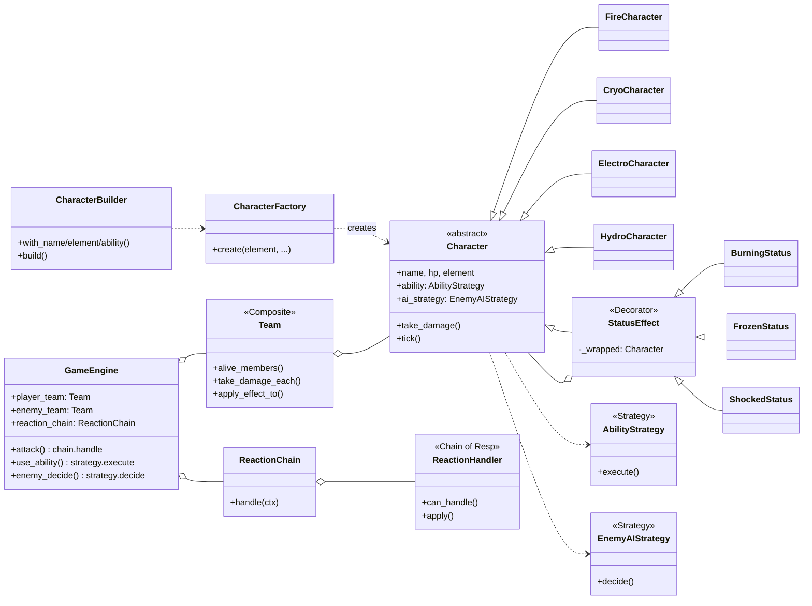

# Element Blast

> A 3v3 turn-based elemental battle engine in Python, structured around six GoF design patterns (seven applications).

> 🇹🇷 **Türkçe özet:** Element Blast, dört element arası reaksiyonların, yeteneklerin ve düşman AI'sının tasarım örüntüleriyle genişletilebilir biçimde kurulduğu 3v3 sıra tabanlı bir dövüş motorudur. Her örüntünün nerede ve hangi sorunu çözmek için kullanıldığı [PATTERNS.md](PATTERNS.md) dosyasında (Türkçe) belgelenmiştir.

[](https://github.com/eemresari/ELEMENT-BLAST/actions/workflows/ci.yml)

## Overview

Element Blast is a console-based, turn-based battle game with a deliberately small domain (four elements, four abilities, a handful of reactions) so that the **architecture** is the interesting part. It started as a single `GameEngine` god class full of `if-elif` chains and was refactored over three phases into a set of small, replaceable pieces. Built for a Software Design Patterns course (3 phases).

Runs on plain Python 3.11+ with no runtime dependencies.

## Design patterns at a glance

Each pattern was introduced to remove a concrete problem found in the Phase 0 code ([PROBLEMS.md](PROBLEMS.md)). Full write-ups with before/after code are in [PATTERNS.md](PATTERNS.md).

| # | Pattern | Category | Phase | Where | Problem it removed |
|---|---------|----------|-------|-------|--------------------|
| 1 | **Factory Method** | Creational | 1 | [characters/factory.py](src/game/characters/factory.py) | Element type-check chains in the engine |
| 2 | **Builder** | Creational | 1 | [characters/builder.py](src/game/characters/builder.py) | Inflexible character setup |
| 3 | **Composite** | Structural | 2 | [team.py](src/game/team.py) | Duplicated AoE code and an HP-cap hack |
| 4 | **Decorator** | Structural | 2 | [effects/status.py](src/game/effects/status.py) | Status effects leaking into `Character` |
| 5 | **Strategy** (abilities) | Behavioral | 3 | [abilities/](src/game/abilities/) | Ability `if-elif` chain |
| 6 | **Strategy** (enemy AI) | Behavioral | 3 | [ai/](src/game/ai/) | One-size-fits-all enemy behavior |
| 7 | **Chain of Responsibility** | Behavioral | 3 | [reactions/](src/game/reactions/) | Reaction `if-elif` chain |

### Open/Closed in practice

Thanks to the reaction chain, a new elemental reaction can be added **without touching `engine.py`**:

```python
class CryoElectroHandler(ReactionHandler):
    def can_handle(self, ctx):
        return ctx.attacker.element == "cryo" and ctx.target.element == "electro"
    def apply(self, ctx):
        ...

engine.reaction_chain.append(CryoElectroHandler())
```

This is verified by [`test_ocp_new_reaction_handler_appended_without_engine_change`](tests/test_smoke.py).

## Features

- **4 elements:** Fire, Cryo, Electro, Hydro
- **6 reaction handlers plus a default fallback:** Fire to Cryo (2x), Fire to Hydro (1.5x plus burning), Hydro to Fire (1.5x), Cryo to Hydro (freeze), Hydro to Electro (1.5x split across the enemy team), Electro to Fire (splash damage plus shock)
- **4 abilities:** Fire Blast (single target, 1.5x), Freeze Ray, Thunder Chain (AoE), Tidal Wave (AoE)
- **3 stackable status effects:** Burning (damage over time), Frozen (skips a turn), Shocked (next hit deals 1.5x)
- **2 game modes:** Quick start (default 3v3) and Custom draft (pick from a pool)
- **Defensive enemy AI** that changes its choices when HP is low

## Architecture



## Tech stack

Python 3.11+ (standard library only), pytest for tests, GitHub Actions for CI, PlantUML diagrams under `docs/diagrams/`. An optional `pygame` extra is declared in `pyproject.toml`.

## Testing and CI

```bash
pip install pytest
pytest tests/ -v
```

12 smoke tests cover Composite, Decorator, Strategy, Chain of Responsibility and the open/closed demo. GitHub Actions runs them on every push (Python 3.11, see [.github/workflows/ci.yml](.github/workflows/ci.yml)).

## Project status

Completed as a three-phase course project. Each phase has its own branch on the remote (`phase-1`, `phase-2`, `phase-3`) and `main` holds the final state.

| Phase | Branch | Focus |
|-------|--------|-------|
| 0 | `main` (initial) | Baseline: god class, `if-elif` chains (analysis in [PROBLEMS.md](PROBLEMS.md)) |
| 1 | `phase-1` | Creational: Factory Method, Builder |
| 2 | `phase-2` | Structural: Composite, Decorator |
| 3 | `phase-3` | Behavioral: Strategy, Chain of Responsibility, CI |

## Repository layout

```text
.
├── README.md
├── PATTERNS.md            # Every pattern: motivation, before/after, location (Turkish)
├── PROBLEMS.md            # Phase 0 design analysis (Turkish)
├── run.py                 # Entry point
├── src/game/
│   ├── characters/        # Factory Method, Builder, Character hierarchy
│   ├── effects/           # Decorator (StatusEffect)
│   ├── team.py            # Composite
│   ├── abilities/         # Strategy (abilities)
│   ├── ai/                # Strategy (enemy AI)
│   ├── reactions/         # Chain of Responsibility
│   ├── engine.py
│   └── main.py
├── tests/                 # pytest smoke tests + open/closed demo
├── docs/
│   ├── diagrams/          # PlantUML, phase by phase (before/after)
│   └── ai-log/            # Notes on AI assistance per phase
└── .github/workflows/ci.yml
```

## Running locally

Requires Python 3.11+. From the repository root:

```bash
python run.py
```

Controls: pick a mode with `q` (quick start) or `c` (custom draft), then on each turn press `a` (attack) or `s` (special ability) and enter the enemy number for single-target actions.

If you launch from an IDE, run `run.py` rather than `main.py`; `main.py` uses package-relative imports.
